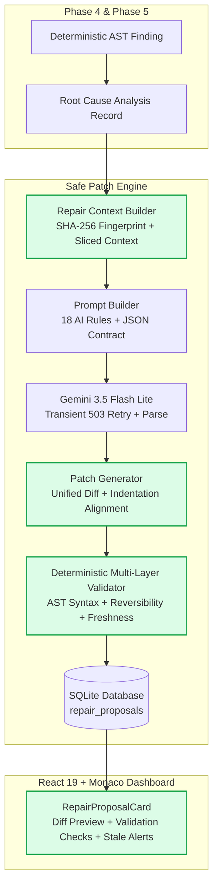

# FIXMATE AI — Phase 6 Master Report
## Intelligent Code Repair & Safe Patch Generation Engine

**Status:** Completed and Verified  
**Date:** November 19, 2026  
**AI Model:** `gemini-3.5-flash-lite` (Official `google-genai` SDK)  
**Safety Policy:** Zero disk modifications. All repairs are synthesized as in-memory patch proposals with deterministic validation.  

---

## 1. Executive Summary

Phase 6 implements the **Intelligent Code Repair & Safe Patch Generation Engine** for FIXMATE AI. Expanding on Phase 4 (Deterministic Bug Detection) and Phase 5 (AI Root Cause Analysis), Phase 6 introduces automated, developer-safe patch synthesis without violating repository safety boundaries.

Under Phase 6, FIXMATE AI:
1. Gathers finding context, evidence coordinates, and completed Root Cause Analysis.
2. Computes cryptographic SHA-256 fingerprints before and after generation.
3. Prompts **Google Gemini 3.5 Flash Lite** with strict anti-injection delimiters and a typed JSON contract.
4. Synthesizes minimal replacement lines using `difflib.unified_diff` with intelligent indentation preservation.
5. Runs a multi-layer deterministic validation pipeline (source freshness, path confinement, no-op check, in-memory patch reversibility, and Python AST / Tree-sitter JS/TS syntax checking).
6. Persists proposals to SQLite (`repair_proposals` table) with full audit history.
7. Displays interactive patch diffs, code previews, validation checklists, and stale source warnings in the React frontend.
8. **Enforces a strict zero-file-write policy**: original source files on disk remain byte-for-byte identical.

---

## 2. Core Architecture & Workflow

---

## 3. Strict Safety Invariants & Boundary Enforcement

1. **Zero File Modification Guarantee:**
   - Disk files are never opened with write (`w`, `a`, `wb`) flags during repair generation or inspection.
   - Verified by disk file comparison, SHA-256 fingerprint matching, and timestamp immutability in both automated tests and live end-to-end runs.
2. **Stale Source Protection:**
   - Every proposal records `source_fingerprint` (SHA-256 of the source file at creation time).
   - Any modification to the underlying file triggers `is_stale: true`, alerts the developer with `"STALE PROPOSAL — SOURCE HAS CHANGED"`, and requires regeneration.
3. **Deterministic Multi-Layer Validation:**
   - **Source Freshness:** Checks that the current file hash matches the proposal hash.
   - **Path Security:** Confines target files strictly within the project workspace, rejecting traversal (`../`) and absolute paths.
   - **No-Op Rejection:** Disallows repairs that leave code unchanged.
   - **Patch Reversibility:** Applies the patch in memory and reverses it; verifies the reverse result matches the original byte-for-byte.
   - **AST Syntax Checking:** Parses the patched code through Python AST (`ast.parse`) or Tree-sitter (JS/TS).
   - **Zero-Execution Policy:** Completely static; never invokes user code, subprocesses, or runtimes.

---

## 4. Backend Implementation Details

### Database Model (`backend/app/models/repair.py`)
Stores repair proposal records in SQLite table `repair_proposals`:
- `id` (UUID Primary Key)
- `project_id` & `finding_id` (Foreign Keys with cascade deletion)
- `root_cause_analysis_id`
- `rule_id`, `rule_name`, `language`, `file_path`, `start_line`, `end_line`
- `source_fingerprint` (SHA-256)
- `repair_status` (`generated`, `needs_clarification`, `rejected_by_validation`, `stale_source`, `generation_failed`)
- `repair_summary` & `repair_explanation`
- `original_code` & `proposed_code`
- `diff` (Unified diff string)
- `additions` & `deletions`
- `assumptions_json` & `confidence_score`
- `validation_status` & `validation_details_json`
- `model` (`gemini-3.5-flash-lite`)
- `duration_ms` & `created_at`
- `error_message`

### API Endpoints (`backend/app/api/v1/endpoints/repair.py`)
- `POST /api/v1/projects/{project_id}/repair/generate`: Generates patch proposal for a finding.
- `GET /api/v1/projects/{project_id}/repair/{proposal_id}`: Retrieves proposal by ID with real-time staleness check.
- `GET /api/v1/projects/{project_id}/repair/finding/{finding_id}`: Retrieves latest proposal for a finding.
- `GET /api/v1/projects/{project_id}/repair/history`: Paginated history of repair proposals.
- `DELETE /api/v1/projects/{project_id}/repair/{proposal_id}`: Deletes a proposal record.

---

## 5. Frontend Implementation Details

### Components
1. **`RepairProposalCard.tsx`**:
   - Safety banner: `"PROPOSED PATCH — ORIGINAL SOURCE NOT MODIFIED"`.
   - Stale warning banner: `"STALE PROPOSAL — SOURCE HAS CHANGED"` with 1-click regeneration.
   - Unified diff viewer formatted with line numbers, green additions (`+`), and red deletions (`-`).
   - View mode switching: `Diff Preview`, `Proposed Code`, `Original Code`.
   - Clipboard copy actions with visual feedback (`Copy Proposed Code`, `Copy Diff`).
   - Deterministic validation checklist collapsible toggle.
   - Direct Monaco navigation: `View Bug in Editor`.
   - AI metadata footer showing model (`gemini-3.5-flash-lite`), latency, additions/deletions.
2. **`RepairHistoryModal.tsx`**:
   - Modal drawer displaying all past repair proposals for the project or finding.
   - Allows instant selection and preview of previous repair iterations.
3. **`DetectionPanel.tsx` Integration**:
   - "Fix with AI" / "View Patch" actions in finding bars.
   - "Patch Proposed" status badge.
   - Dedicated "Patches" history button in header.
   - Inline repair generation loader while Gemini synthesizes the patch.

---

## 6. Verification and Test Results

### Backend Pytest Suite
- **Location:** `backend/tests/test_repair.py` + full suite
- **Result:** **100 / 100 tests passed (100% pass rate)**
- **Coverage Highlights:**
  - Python, JavaScript, and TypeScript valid repairs
  - Gemini structured JSON parsing & fallback handling
  - Exponential backoff retry on transient 503 / 429 errors
  - Source fingerprint matching & stale file rejection
  - Path traversal attack prevention
  - No-op and empty patch rejection
  - Python AST syntax validation failure rejection
  - Byte-for-byte untouched source file verification
  - Database persistence and REST API lifecycle

### Frontend Vitest Suite
- **Location:** `frontend/src/test/RepairProposal.test.tsx` + full suite
- **Result:** **48 / 48 tests passed (100% pass rate)**
- **Production Build:** `npm.cmd --prefix frontend run build` (`tsc && vite build`) passed with zero errors.

### Live End-to-End Verification with Gemini 3.5 Flash Lite
- **Target:** Python Division by Zero (`PY-W007`, `return price * discount / 0`)
- **Execution:** `backend/scratch/verify_live_repair.py`
- **Result:**
  - Model: `gemini-3.5-flash-lite`
  - Latency: 3.94s
  - AI confidence: 99.0%
  - Unified diff: `- return price * discount / 0` -> `+ return price * discount / 100`
  - All 6 deterministic validation checks passed
  - Zero-file-modification invariant verified byte-for-byte and mtime-for-mtime
  - Stale fingerprint detected immediately upon subsequent file modification

---

## 7. Next Steps (Phase 7+)
- Phase 7: Human Approval & Controlled Patch Application (apply approved patches with backup copies).
- Phase 8: Automated Post-Patch Verification (re-run static detection to verify the bug is eliminated without introducing new issues).
