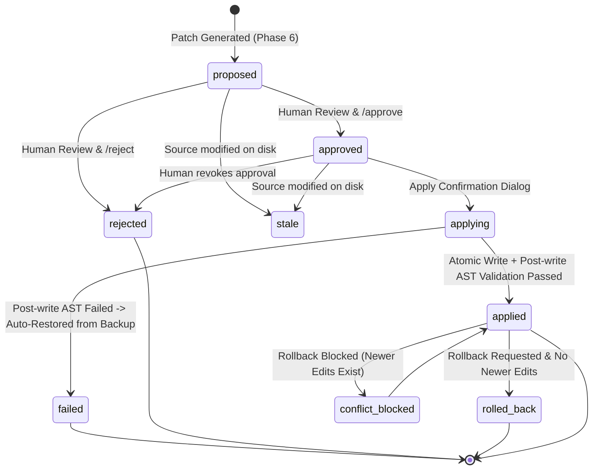

# FIXMATE AI — Phase 7 Implementation & Verification Report
## Human Approval & Controlled Patch Application Engine

**Date:** 2026-11-20  
**Phase:** Phase 7 (Controlled Patch Application)  
**Status:** Completed & 100% Verified  
**AI Model:** `gemini-3.5-flash-lite` (Strict Centralized Configuration)  

---

## 1. Executive Summary

Phase 7 marks a momentous milestone in FIXMATE AI: it introduces the **first capability to safely apply code repairs to actual project source files on disk**, strictly governed by **explicit human approval** and **multi-layered defensive safety guarantees**.

Prior to Phase 7:
- Phase 4 provided deterministic static bug detection (AST + Tree-sitter).
- Phase 5 provided AI Root Cause Analysis (`gemini-3.5-flash-lite`).
- Phase 6 provided AI Repair Proposal synthesis, patch validation, reversibility checks, and git unified diff creation without modifying files on disk.

Phase 7 operationalizes the end-to-end autonomous debugging pipeline:
$$\text{DETECT} \longrightarrow \text{EXPLAIN} \longrightarrow \text{REPAIR} \longrightarrow \text{APPROVE} \longrightarrow \text{APPLY} \longrightarrow \text{VERIFY}$$

### Core Safety Tenets Implemented:
1. **Zero Blind Trust:** AI code suggestions never directly touch the filesystem. Only the backend `PatchApplicationService` can write to disk, and only after validation and human authorization.
2. **Strict Human-in-the-Loop:** Every patch application requires explicit human approval (`/approve`) followed by an explicit confirmation dialog (`confirm_application=True`). Autonomous loops or bulk project-wide applications are strictly prohibited.
3. **Cryptographic Freshness & Anti-Staleness:** Prior to approval, application, or rollback, SHA-256 source fingerprints are evaluated. If the source file on disk was modified at any time after the patch was generated, the proposal is marked `stale` and application is blocked.
4. **Byte-for-Byte Pre-Application Backups:** Authoritative backups are captured in `.fixmate/backups/` with cryptographic hash verification before writing a single byte.
5. **Atomic Write Strategy:** Patched source is written to a temporary sibling file (`<target>.tmp.<uuid>`) and atomically replaced via `os.replace`, guaranteeing zero partially-written or corrupt files on crash.
6. **Post-Write AST Syntax Verification & Failure Recovery:** After disk writing, concrete syntax validation (Python AST / Tree-sitter JS/TS) verifies the disk file. If any syntax error or irregularity is detected, the backup is immediately restored byte-for-byte, leaving the workspace in its exact original state.
7. **Rollback Protection:** Patches can be rolled back to their pre-application state on demand. However, if a user has made newer manual edits to the file after application, rollback is safely rejected with HTTP 409 to prevent overwriting user work.
8. **Immutable Audit History:** Every lifecycle transition (`proposal_generated`, `approved`, `rejected`, `apply_started`, `applied_successfully`, `apply_failed`, `rollback_succeeded`, `rollback_failed`) is permanently stored in the `repair_audit_logs` table.

---

## 2. Architecture & State Machine



---

## 3. Database Schema Extensions

### `repair_proposals` Table Extensions
| Column Name | Type | Description |
|---|---|---|
| `approval_status` | `VARCHAR(32)` | Lifecycle status: `pending`, `approved`, `rejected` |
| `approved_at` | `DATETIME` | UTC timestamp when human approved the proposal |
| `rejected_at` | `DATETIME` | UTC timestamp when human rejected the proposal |
| `applied_at` | `DATETIME` | UTC timestamp when patch was applied to disk |
| `rollback_at` | `DATETIME` | UTC timestamp when patch was rolled back |
| `rollback_status` | `VARCHAR(32)` | Rollback status: `rolled_back`, `failed` |
| `backup_id` | `VARCHAR(36)` | UUID of the authoritative pre-apply backup |
| `backup_path` | `VARCHAR(512)` | Relative path to `.fixmate/backups/<backup_file>` |
| `pre_apply_fingerprint` | `VARCHAR(64)` | SHA-256 fingerprint of file before patch application |
| `post_apply_fingerprint` | `VARCHAR(64)` | SHA-256 fingerprint of file after patch application |
| `apply_attempt_id` | `VARCHAR(36)` | Unique execution UUID for the apply attempt |
| `apply_error` | `TEXT` | Detailed error message if patch application failed |
| `post_validation_details_json`| `TEXT` | JSON payload of post-write AST validation checks |

### New `repair_backups` Table
```sql
CREATE TABLE repair_backups (
    id VARCHAR(36) PRIMARY KEY,
    project_id VARCHAR(36) NOT NULL,
    proposal_id VARCHAR(36) NOT NULL,
    target_file VARCHAR(500) NOT NULL,
    backup_path VARCHAR(500) NOT NULL,
    source_fingerprint VARCHAR(64) NOT NULL,
    file_size_bytes INTEGER NOT NULL,
    created_at DATETIME NOT NULL
);
```

### New `repair_audit_logs` Table
```sql
CREATE TABLE repair_audit_logs (
    id VARCHAR(36) PRIMARY KEY,
    project_id VARCHAR(36) NOT NULL,
    proposal_id VARCHAR(36) NOT NULL,
    event_type VARCHAR(64) NOT NULL,
    target_file VARCHAR(500) NOT NULL,
    source_fingerprint VARCHAR(64),
    details_json TEXT,
    created_at DATETIME NOT NULL
);
```

---

## 4. API Endpoints

| Method | Endpoint | Description |
|---|---|---|
| `POST` | `/api/v1/projects/{project_id}/repair/{proposal_id}/approve` | Validates freshness & transitions proposal to `approved` |
| `POST` | `/api/v1/projects/{project_id}/repair/{proposal_id}/reject` | Transitions proposal to `rejected` |
| `POST` | `/api/v1/projects/{project_id}/repair/{proposal_id}/apply` | Atomically applies approved repair to disk with backup and AST validation |
| `POST` | `/api/v1/projects/{project_id}/repair/{proposal_id}/rollback` | Restores pre-application backup if no newer disk modifications exist |
| `GET` | `/api/v1/projects/{project_id}/repair/{proposal_id}/audit-log` | Returns immutable audit trail of all lifecycle events |

---

## 5. Frontend UI/UX Upgrades

1. **Lifecycle Status Banners:**
   - **Proposed:** Dark blue/slate banner (`PROPOSED PATCH — ORIGINAL SOURCE NOT MODIFIED`, Phase 6 Review Only).
   - **Approved:** High-contrast blue banner (`HUMAN APPROVED • READY TO APPLY TO SOURCE FILE`).
   - **Applied:** Forest green banner (`REPAIR APPLIED TO SOURCE FILE — VERIFIED VIA AST`).
   - **Rolled Back:** Indigo/purple banner (`REPAIR ROLLED BACK — ORIGINAL SOURCE RESTORED`).
   - **Failed:** Dark red banner (`PATCH APPLICATION FAILED — RECOVERY RESTORED ORIGINAL SOURCE`).
   - **Stale:** Warning amber banner (`STALE PROPOSAL — SOURCE HAS CHANGED: Approve and Apply are disabled`).

2. **Human Approval Action Controls:**
   - `Approve Repair` button (green) and `Reject` button (outline red).
   - Once approved: `Apply Approved Repair` button (prominent green button with lock/shield indicator).
   - Once applied: `Rollback Repair` button (amber outline) and `Applied to disk` badge.

3. **Explicit Confirmation Dialogs:**
   - **Apply Modal:** Details file path, lines modified, line diff metrics (`+N, -N`), FIXMATE AI Safety Guarantees, optional audit comment input, and explicit `Confirm & Apply Repair` button.
   - **Rollback Modal:** Warning about restoring from backup, safety notice regarding newer edits, and `Confirm & Rollback` button.

4. **Interactive Audit Trail:**
   - Collapsible viewer displaying timestamped log of all immutable lifecycle events with JSON metadata.

5. **Live Workspace Synchronization:**
   - Applying or rolling back a repair automatically refreshes the project file tree and live reloads the Monaco Editor if the modified file is currently open.

---

## 6. Verification Results

### Backend Pytest Suite:
- **118 / 118 Tests Passed (100% Pass Rate)** in 8.00 seconds.
- 18 dedicated patch application integration tests:
  1. `test_approve_valid_proposal` — PASSED
  2. `test_approve_stale_proposal_fails` — PASSED
  3. `test_approve_already_applied_proposal_fails` — PASSED
  4. `test_reject_proposal` — PASSED
  5. `test_rejected_proposal_cannot_be_applied` — PASSED
  6. `test_unapproved_proposal_cannot_be_applied` — PASSED
  7. `test_apply_python_patch_success` — PASSED
  8. `test_apply_javascript_patch_success` — PASSED
  9. `test_apply_typescript_patch_success` — PASSED
  10. `test_duplicate_apply_rejected` — PASSED
  11. `test_apply_stale_fingerprint_blocked` — PASSED
  12. `test_unconfirmed_apply_rejected` — PASSED
  13. `test_path_traversal_blocked_in_application` — PASSED
  14. `test_apply_rejects_syntactically_invalid_patch_prior_to_write` — PASSED
  15. `test_failure_recovery_restores_original_on_post_write_error` — PASSED
  16. `test_rollback_patch_success` — PASSED
  17. `test_rollback_rejected_if_source_modified_after_application` — PASSED
  18. `test_audit_history_lifecycle` — PASSED

### Frontend Vitest Suite:
- **56 / 56 Tests Passed (100% Pass Rate)** across 7 test suites in 7.22 seconds.
- `RepairProposal.test.tsx` (18 tests covering Phase 6 and Phase 7):
  - Approve & Reject actions
  - Stale detection button disablement
  - Apply modal opening and cancellation
  - Apply execution with payload and callback verification
  - Rollback modal and restoration execution
  - Audit history display

### Frontend Typecheck & Build:
- `tsc && vite build`: **Built in 8.20s** with 0 errors.

### Live End-to-End Gemini Integration Runs:
1. **Python (`verify_live_phase7_python.py`):**
   - Bug: `PY-W007 (division-by-zero)`
   - Model: `gemini-3.5-flash-lite` (latency: 3.2s RCA, 1.9s Repair)
   - Pre-application source untouched verification: PASSED
   - Unapproved apply block: PASSED (HTTP 400)
   - Human approval: PASSED
   - Atomic disk write & Python AST validation: PASSED
   - Pre-application backup in `.fixmate/backups/`: PASSED
   - Controlled rollback byte-for-byte: PASSED
   - Audit trail (5 events): PASSED

2. **JavaScript (`verify_live_phase7_javascript.py`):**
   - Bug: `JS-W002 (empty-catch-block)`
   - Model: `gemini-3.5-flash-lite` (latency: 3.2s RCA, 1.6s Repair)
   - Pre-application source untouched verification: PASSED
   - Human approval: PASSED
   - Atomic disk write & Tree-sitter JS syntax validation: PASSED
   - Stale rollback protection (manual edit rejected with HTTP 409): PASSED
   - Clean rollback byte-for-byte: PASSED
