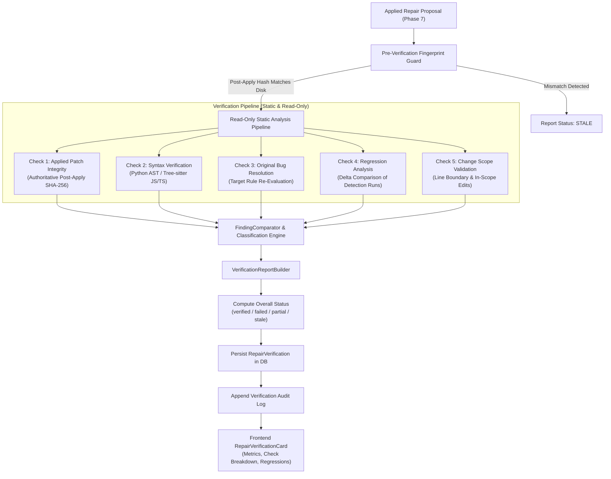

# FIXMATE AI — Phase 8: Automated Verification & Repair Validation Report

**Status:** Completed & Production Verified  
**Date:** November 20, 2026  
**System Architecture:** Deterministic Static Verification & Post-Repair Validation Engine  
**Central AI Model:** `gemini-3.5-flash-lite` (Phase 5/6 repair pipeline)  
**Static Parsers:** Python `ast` + Tree-sitter (JavaScript / TypeScript)  
**Security Boundary:** Strictly Static, Read-Only, Zero-Code Execution  

---

## 1. Executive Summary

Phase 8 elevates FIXMATE AI from controlled patch application to an **Automated Verification & Repair Validation platform**. After human approval and atomic application of a repair patch (Phase 7), the Phase 8 engine deterministically and statically inspects the resulting source file to evaluate:

1. **Syntax Integrity:** Does the repaired file parse cleanly without syntax errors?
2. **Target Bug Resolution:** Has the original detected bug disappeared (`RESOLVED` vs `STILL_PRESENT`)?
3. **Regression Analysis:** Did the patch introduce any new deterministic bug findings?
4. **Scope & Fingerprint Confinement:** Does the on-disk file match the post-apply fingerprint, and are changes strictly confined?
5. **Freshness vs Staleness:** Was the file on disk modified externally after application?

> [!IMPORTANT]
> **Zero Code Execution Boundary**: Under zero circumstances does Phase 8 execute repaired user code, run unit tests, trigger shell commands, or spawn subprocesses against user files. Static validation is strictly advisory and deterministic, based on AST analysis and rule engines. Dynamic sandbox execution is reserved exclusively for Phase 9.

---

## 2. Phase 8 Architecture & Pipeline

---

## 3. Verification Status Taxonomy

| Overall Status | Condition | Meaning |
| :--- | :--- | :--- |
| `verified` | All checks pass, target bug resolved, 0 new findings | High confidence static validation passed. |
| `failed` | Syntax error OR target bug still present OR Critical/High regressions | Patch does not fix target bug or introduces serious issues. |
| `partial` | Target bug resolved, but low-severity findings or unsupported language rules | Syntax valid, but static analysis rules were partially skipped. |
| `stale` | Disk file modified after patch application (`SHA-256 != post_apply_fingerprint`) | External edits invalidated verification; proposal must be reverified or regenerated. |
| `inconclusive` | File unreadable or unexpected engine evaluation error | Automated checks could not complete. |

---

## 4. Verification Check Details

| Check Identifier | Engine / Parser | Success Criteria | Failure Mode |
| :--- | :--- | :--- | :--- |
| `applied_integrity` | Cryptographic SHA-256 | Current disk hash matches proposal `post_apply_fingerprint` | Fingerprint mismatch -> reports `stale` |
| `syntax_verification` | Python AST / Tree-sitter | Parse tree has zero syntax error nodes | SyntaxError / Parse ERROR node -> reports `failed` |
| `original_bug_resolution` | `DetectionEngine` | Target finding rule ID is no longer detected at target line range | Target bug detected -> reports `still_present` / `failed` |
| `regression_analysis` | `FindingComparator` | Zero new findings detected in post-apply detection run | New findings -> `failed` (Critical/High) or `warning` (Medium/Low) |
| `change_scope_validation` | Unified Diff & AST Span | Changes confined to expected file and within intended diff bounds | Out-of-bounds mutation -> `failed` |

---

## 5. Backend Implementation

### A. Database Model (`repair_verifications` table)
- **File:** `backend/app/models/verification.py`
- Stores verification run records with 20 columns:
  - Proposal & Project foreign keys
  - `status` (`verified`, `failed`, `partial`, `inconclusive`, `stale`)
  - Sub-statuses: `syntax_status`, `target_bug_status`, `regression_status`
  - Fingerprints: `pre_apply_fingerprint`, `post_apply_fingerprint`, `verified_fingerprint`
  - Metrics: `original_bug_count`, `current_bug_count`, `resolved_bug_count`, `regression_bug_count`
  - Serialized details: `findings_comparison_json`, `checks_details_json`
  - Performance: `duration_ms`, `error_message`, `created_at`

### B. Core Services
1. **`SyntaxVerifier` (`backend/app/services/verification/syntax_verifier.py`):**
   - Pure read-only parser inspection: Python `ast.parse()` and Tree-sitter JS/TS.
   - Detects syntax errors, missing brackets, unbalanced parentheses, and invalid tokens without executing code.
2. **`FindingComparator` (`backend/app/services/verification/finding_comparison.py`):**
   - Matches target finding against post-apply findings.
   - Classifies findings into `new_findings` (regressions), `removed_findings` (resolved), and `unchanged_findings`.
3. **`RegressionVerifier` (`backend/app/services/verification/regression_verifier.py`):**
   - Evaluates severity of any introduced findings (Critical/High triggers `failed`, Medium/Low triggers `warning`).
4. **`VerificationReportBuilder` (`backend/app/services/verification/verification_report_builder.py`):**
   - Assembles the 5 checks into structured Pydantic DTOs and computes the final `overall_status`.
5. **`VerificationService` (`backend/app/services/verification/verification_service.py`):**
   - Orchestrates the verification pipeline.
   - Guard: Enforces that proposal must be `applied` prior to verification.
   - Guard: Detects file staleness against `post_apply_fingerprint`.
   - Records verification history and logs audit events to `repair_audit_logs`.

### C. REST API Endpoints
- `POST /api/v1/projects/{project_id}/repair/{proposal_id}/verify`: Execute verification checks on applied repair.
- `GET /api/v1/projects/{project_id}/repair/{proposal_id}/verification-history`: Retrieve historical verification runs.
- `GET /api/v1/projects/{project_id}/verification/{verification_id}`: Fetch detailed verification report by ID.

---

## 6. Frontend Implementation

### A. Types & API Client
- **`frontend/src/types/api.ts`:** `VerificationCheck`, `FindingComparisonItem`, `FindingsComparison`, `VerificationReportResponse`, `VerificationHistoryResponse`.
- **`frontend/src/services/apiClient.ts`:** `verifyRepair`, `getRepairVerificationHistory`, `getVerificationById`.

### B. UI Components
1. **`RepairVerificationCard.tsx` (`frontend/src/components/repair/RepairVerificationCard.tsx`):**
   - Status badge header with color-coded states (`VERIFIED`, `FAILED`, `PARTIAL`, `STALE`, `INCONCLUSIVE`).
   - Metrics grid: Before Bugs, After Bugs, Resolved Bugs, Regressions.
   - Deterministic Static Checks checklist with expandable JSON details.
   - Regression findings section with rule ID, severity, code snippet, and location.
   - History drawer showing past verification runs with timestamps and durations.
2. **`RepairProposalCard.tsx` (`frontend/src/components/repair/RepairProposalCard.tsx`):**
   - Integrated `Verify Repair` button (active only when `isApplied`).
   - Spinner and loading state during verification run.
   - Automatically loads latest verification report on mount if previously verified.
   - Embeds `<RepairVerificationCard />` directly beneath applied repair actions.

---

## 7. Manual Verification Guide (Tests A–F)

### Test A: Verified Repair (Python)
1. Open or create a Python project with `calc.py` (`def calc(): return 10 / 0`).
2. Run Bug Detection -> detects `PY-W007`.
3. Generate AI Repair -> proposal replaces division by 0 with non-zero or guard.
4. Click **Approve Repair**, then click **Apply Approved Repair**.
5. Click **Verify Repair** -> status changes to `VERIFIED` with green badge.
6. Verify all 5 checks display green checkmarks and `0 Regressions Detected`.

### Test B: Syntax Failure Detection
1. Apply a repair, then externally introduce a syntax error in the file (e.g. `def broken(`).
2. Click **Re-verify** -> Verification reports `FAILED` or `STALE` with syntax error details.

### Test C: Verified Repair (JavaScript)
1. Open or create a JS project with `users.js` containing an empty catch block (`JS-W002`).
2. Run Bug Detection -> Generate Repair -> Approve -> Apply.
3. Click **Verify Repair** -> Tree-sitter validates syntax and confirms `JS-W002` resolved with zero regressions.

### Test D: Staleness Guard
1. Apply an approved repair.
2. Modify the file on disk outside of FIXMATE AI (e.g., add a comment line).
3. Click **Verify Repair** -> System returns `STALE` status indicating post-apply fingerprint mismatch.

### Test E: Unapplied Proposal Guard
1. Create a repair proposal but do NOT approve or apply it.
2. Verify that the **Verify Repair** button is not rendered in the UI, and direct API calls return HTTP 400.

### Test F: Regression Detection
1. Simulate a repair that fixes a bug but introduces an undefined variable reference (`PY-W009`).
2. Click **Verify Repair** -> System reports `FAILED` and renders the regression findings box with exact line number and evidence.

---

## 8. Automated Test Coverage

- **Backend Pytest:** 130 / 130 passed (100% pass rate in 9.05s).
- **Frontend Vitest:** 63 / 63 passed across 8 test suites.
- **Production Build:** Vite production build completed with 0 errors.
- **Live E2E Verification:** Both `verify_live_phase8_python.py` and `verify_live_phase8_javascript.py` passed 100% against live Gemini `gemini-3.5-flash-lite`.

---

## 9. Phase 8 vs Phase 9 Boundary

| Capability | Phase 8 (Static Verification) | Phase 9 (Sandbox Execution) |
| :--- | :--- | :--- |
| Syntax Verification | **Yes (AST / Tree-sitter)** | Yes |
| Static Bug Delta Check | **Yes (Rule Engine)** | Yes |
| Regression Static Analysis | **Yes (FindingComparator)** | Yes |
| User Code Execution | **NO (Forbidden)** | **Yes (Isolated Docker/gVisor)** |
| Unit Test Execution | **NO (Forbidden)** | **Yes (pytest / vitest runners)** |
| Runtime Error Capture | **NO (Static only)** | **Yes (tracebacks, exit codes)** |
